  

# Plant-Meristem-Longevity-Research

## Author
**RIDDHIKA D**  
Email: `riddhika.d9b@gmail.com`

---

## Disclosures
1. **AI assistance.** Developed by the author with AI assistance Gemini Notebook / NotebookLM and Python in Google Colab. Claims not yet checked against primary sources should be treated as unverified.
2. **Simulated data.** `analyze_tree_neb_SIMULATED.py` and its outputs (`tree_neb_cohort_summary_metrics.csv`, `tree_neb_snrna_counts_summary.csv`, `tree_neb_snrna_analysis.png`) are *simulated* (`np.random`, seed 42). Cohort differences are pre-programmed inputs, not empirical biological findings. Some notebook tables (e.g. Stage 51 gene features) are hand-entered illustrative values.
3. **Candidate values.** Numerical values quoted in some project files are candidate values until accessions, method and output are documented. In particular, a Ginkgo–human Ku70 identity (previously reported as 68.4%) has not been computed: BLAST searches on 2026-10-15 found no Ginkgo Ku70 record in NCBI nr or the searched WGS database.

---

## ⭐ Data analysis: microRNAs in ageing Ginkgo cambium (v3, 2026-11-04)
The one part of this project that analyses real measured data.

**Question:** do microRNAs in the vascular cambium (the lateral meristem that makes wood) change with tree age?

**Data:** NCBI GEO [GSE119213](https://www.ncbi.nlm.nih.gov/geo/query/acc.cgi?acc=GSE119213), from Wang et al., *PNAS* 117:2201 (2020), "Multifeature analyses of vascular cambial cells reveal longevity mechanisms in old *Ginkgo biloba* trees". Small-RNA counts from trees aged 20, 200 and 600 years, **2 trees per age**. Data generation and the original analysis are by Wang et al.; this repository is an independent re-analysis by the author.

**Method** (`ginkgo_mirna_age_v3.ipynb`, runs in Colab in about 1 minute):
- Merged miRNA names that are the same Ginkgo molecule matched to several species' reference names (632 names → 601 molecules)
- CPM normalisation, mean CPM ≥ 10 (289 miRNAs)
- Linear trend of log2 CPM against log10(age) across all 6 trees, Benjamini–Hochberg FDR
- miR156 and miR165/166 were pre-specified before looking at results

**Results**

| Finding | Result |
|---|---|
| **miR397 falls with age** | 77-fold lower at 600 y than 20 y (log2FC −6.27, r = −0.995, **FDR = 0.01**); the only miRNA with FDR < 0.05. **Replicates** Wang et al. 2020, who listed miR397a among miRNAs that differ between young and old trees (Datasets S4/S5) |
| Other changes | 15 miRNAs at FDR < 0.1 (12 fall, 3 rise), mostly unannotated "novel" Ginkgo miRNAs |
| **miR165/166** | 10 of 12 distinct molecules rise with age (sign test p = 0.039); none passes FDR individually. Consistent with Wang et al. 2020, who reported miR166/165 and their targets |
| **miR156** | No reliable change (main form ath-miR156a flat, FDR = 0.85) |

**Interpretation (hypothesis, not proven):** miR397 represses laccase genes, which polymerise lignin. If miR397 drops sharply, laccases should rise in old cambium. Wang et al. 2020 instead saw small, non-significant *falls* in Lac11/Lac17-like laccases (their Fig. 6F). So miR397 loss is not clearly reflected in its known targets; other targets, or regulation at the protein level, may matter. This needs more trees and a direct miRNA–target test.

**Limits:** n = 2 trees per age; one tissue; expression only. miR397 and miR166 changes were already reported by Wang et al. 2020; what this re-analysis adds is a clean duplicate-merged ranking (miR397 is the strongest single age-trend miRNA) and the miR397–laccase mismatch noted above. This is a **replication**, not a new discovery.

**Correction:** an earlier version of this analysis in the main notebook counted the same miR166 molecule under several species names (e.g. "8 strong miR166s") and used fold-change cut-offs without statistics. Those results are superseded by v3.

---

An open-source research project investigating how plant meristem stem-cell maintenance, stress resilience, DNA repair, chromatin regulation, autophagy, and proteostasis contribute to long-term meristem function.

## Research Objective
The project investigates how multiple cellular maintenance systems may interact to preserve plant meristem function during long-term growth and environmental stress.

The current research question is:

How are stem-cell identity, redox signaling, cellular quality control, DNA-damage responses, and chromatin state coordinated to maintain plant meristem function during long-term growth and repeated environmental stress?

## Project Architecture
The project was developed through four major phases:

### Part A — Computational Discovery (Stages 1–21.1)
- Literature and evidence collection
- Research matrix construction
- Structured evidence extraction
- Data integrity checks
- K-Means / unsupervised analysis
- Cluster interpretation
- Research-gap identification
- Hypothesis development
- Computational synthesis

### Part B — Scientific Verification (Stages 22–28)
- Primary-literature verification
- Mechanism-by-mechanism evidence checking
- Cross-mechanism synthesis
- Gap assessment
- Central research question
- Competing hypotheses
- Experimental framework
- Plant-to-human translation boundary

### Part C — Research Prioritization & Protocol Design (Stages 29–31)
- Research-gap prioritization
- Experimental question selection
- Experimental protocol architecture
- Analysis matrix
- Validation and falsification framework

### Part D — Master Integration (Stages 32–34)
*Note: the white paper summarises Stages 1–34; the working notebook uses finer-grained headings numbered up to 54.*
- Final research architecture
- Repository organization
- Documentation
- Reproducibility structure
- Research communication materials

---

## Five Major Biological Domains
1. **Stem-cell identity:** WUS–CLV signaling
2. **Environmental resilience:** Stress, hypoxia, ROS and signaling responses
3. **Genome maintenance:** Ku70/Ku80 and DNA-damage responses
4. **Epigenetic regulation:** Polycomb, H3K27me3 and KNU-related regulation
5. **Cellular quality control:** Autophagy, NBR1, ATG8 and proteostasis
*These domains are investigated as interacting biological systems. The project does not assume that they constitute a single unified longevity pathway.*

---

## Competing Hypotheses
- **H1 — Signaling-dominant model:** WUS–CLV signaling is the primary regulator of meristem maintenance, while other cellular systems mainly modify or support this signaling.
- **H2 — Cellular-maintenance model:** DNA repair, chromatin regulation, proteostasis, autophagy and redox control maintain the cellular environment required for continued stem-cell function.
- **H3 — Network model:** Long-term meristem maintenance emerges from interactions among stem-cell signaling, stress responses, DNA repair, chromatin regulation and cellular quality-control systems.

*H3 remains a testable hypothesis rather than an established conclusion.*

---

## Candidate Research Gaps
*Identified from an AI-assisted literature review; not independently validated.*

1. WUS–CLV and stress-response interaction
2. DNA repair and chromatin coordination
3. Autophagy, proteostasis and ROS interaction
4. Association versus causality
5. Plant-to-human conservation and functional relevance

### Literature search status (as of 2026-10-15)
- Searched so far: PubMed (title/abstract) and the first 10 Google Scholar results (snippet level). Web of Science, Scopus and the remaining Scholar strings are not yet run (see `search_strings_P1_P4_ready.md`; log in `q3_search_log.csv`).
- Reviews already discuss links between autophagy, ROS and meristems, mostly in root (e.g. Cheng 2022; Qin 2023; Liu 2024; Davoudi 2026). The link itself is therefore not claimed as new.
- Whole-plant studies (e.g. Sedaghatmehr 2019; Sedaghatmehr & Balazadeh 2024; Agbemafle 2025 review) indicate that autophagy stays active or is needed during recovery from stress. This conflicts with the simulation assumption that autophagy decays after stress and must be checked against full texts.
- In the screened results, no study was found combining measured autophagic flux, ROS and WUS–CLV in the shoot apical meristem under stress. This is "not identified in the reviewed literature (searched 2026-10-15)", not a claim that none exists.

---

## Initial Experimental Architecture
The first experimental framework is intentionally small:

Arabidopsis SAM  
↓  
Controlled stress  
↓  
Measure ROS and autophagic flux  
↓  
Measure WUS / CLV3  
↓  
Measure SAM recovery and function  
↓  
Compare with an appropriate quality-control perturbation  

*This framework is designed to establish causal relationships before expanding into more complex DNA-repair and chromatin experiments.*

---

## Evidence Hierarchy
The project distinguishes:  
**Association** $\rightarrow$ **Perturbation** $\rightarrow$ **Functional interaction** $\rightarrow$ **Causal mechanism**

*This hierarchy is used to prevent correlations from being presented as demonstrated causal mechanisms.*

---

## Translation Boundary
The project investigates:  
*What cellular maintenance principles can be learned from plant meristems?*

The research does not claim that plant mechanisms directly provide human anti-aging treatments. Any plant-to-human comparison requires independent evidence of molecular conservation and functional relevance.

---

## Repository Contents
The repository contains research matrices, computational outputs, cluster analyses, research-gap frameworks, experimental hypotheses, validation structures and research documentation.

Key files include:
- `research_matrix.csv`
- `clustered_research_matrix.csv`
- `cluster_interpretation.csv`
- `cluster_distribution.png`
- `plant_meristem_final_research_report.csv`
- `prioritized_research_gap_framework.csv`
- `research_track_summary_framework.csv`
- `stage_19_6_experimental_hypotheses.csv`
- `stage_19_7_experimental_testing_validation.csv`
- `ginkgo_mirna_age_v3.ipynb` — clean Ginkgo miRNA re-analysis (canonical data analysis)
- `ginkgo_mirna_age_v3_RUN.ipynb` — executed copy with all outputs
- `Plant_Meristem_Longevity_Research_Lab...ipynb` — exploratory working notebook (contains superseded analyses; the protein-structure section uses PDB 1LCD, a bacterial lac repressor, as a practice example and is unrelated to plants)
- `WHITE-PAPER.md`
- `analyze_tree_neb_SIMULATED.py` and `tree_neb_*` files — **simulated** (see Disclosures)

---

## Reproducibility
The computational workflow was developed using Google Colab and structured research outputs. The repository provides the resulting datasets, analysis outputs and documentation so that the research workflow can be inspected and reproduced. The repository currently holds several copies of the main notebook (`v1`, `v1 (2)`–`v1 (3)`, `v4 to 7(1)`); a single canonical notebook should be designated.

---

## Project Status
- **Ginkgo cambium miRNA re-analysis (real data):** COMPLETE (v3, 2026-11-04)
- **Stages 1–21.1 — Computational Discovery:** COMPLETE
- **Stages 22–28 — Scientific Verification:** COMPLETE
- **Stages 29–31 — Research Prioritization & Protocol Design:** COMPLETE
- **Stages 32–34 — Master Integration:** COMPLETE (white-paper numbering)

*The current project therefore represents a completed research-design and computational-discovery framework. Experimental laboratory validation remains future work.*

---

## Research Principle
The project separates:
- Established evidence
- from Supported interpretations
- from Testable hypotheses
- from Unvalidated translational possibilities

*This boundary is maintained throughout the research.*

---

## License
MIT License
